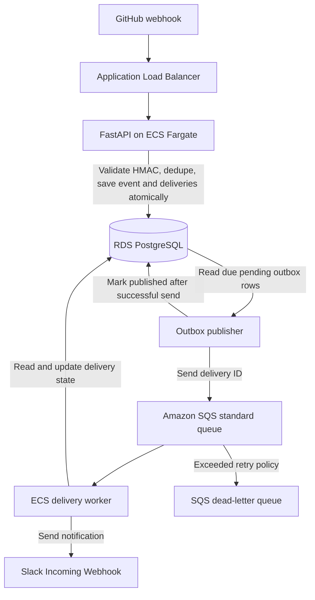

# Multi-Tenant GitHub Webhook Processing Platform

## 1. System overview

This project is a multi-tenant, event-driven backend platform that receives GitHub webhooks, verifies their authenticity, stores events, applies configurable routing rules, and asynchronously delivers notifications to Slack.

The purpose is to demonstrate practical backend engineering, PostgreSQL transactions, asynchronous processing, AWS infrastructure, security, and failure recovery. The implementation should prioritize correctness and simple, understandable code over extra frameworks or features.

**MVP scope:** GitHub is the only event source; Slack Incoming Webhooks are the only notification destination. Multiple tenants can configure their own sources, destinations, and routing rules.

**Deployment plan:** Develop and test locally, deploy to AWS for a real end-to-end demonstration, record results and screenshots, then destroy billable resources. The system is not intended to run continuously.

## 2. Architecture diagram



This is a **logical** diagram, not a complete networking diagram. Keep one codebase and one application image. Plan two ECS services: an API service and a background service with two essential containers, one running the publisher and one running the delivery worker. Each process has one straightforward loop and its own startup command. This avoids a process supervisor or threads coordinating both loops. Restarting either essential container replaces the background task; PostgreSQL and SQS preserve recoverable work. Separate scaling is deferred until measurements justify another service. The API and background task access PostgreSQL; the worker needs outbound HTTPS to Slack.

### AWS network placement

- Internet-facing ALB in public subnets.
- For the temporary, cost-conscious demonstration, use Fargate tasks in public subnets with public IPs and strict security groups. Only the ALB security group can reach the API port; background tasks have no inbound rules. This permits outbound connections without a NAT Gateway. Public addressing is a deliberate demo tradeoff, not a high-availability production baseline.
- RDS PostgreSQL in private database subnets, not publicly accessible.
- Security groups allow only necessary communication (ALB to API; API/worker to RDS).
- Do not add NAT Gateways or a collection of paid interface endpoints by default. Private application subnets with NAT remain a documented upgrade when private task addressing is required; Slack still needs internet egress. Public IPv4 addresses also incur charges, so compare the actual deployment estimate before provisioning.
- IAM task roles grant only required permissions; ECS execution role covers image pulls, logging, and injected secrets.
- HTTPS is required before sending real credentials or authenticated management requests over the public internet. A suitable domain/certificate strategy must be selected before deployment.

## 3. Technology stack

| Area | Technology | Purpose |
|---|---|---|
| Language | Python 3.13 | Backend and worker code |
| HTTP API | FastAPI + Uvicorn | Webhook ingestion and management endpoints |
| Database | PostgreSQL 16 | Durable events, configuration, and delivery state |
| Database access | psycopg 3 | Explicit SQL and transactions; add a small pool only if measured connection overhead warrants it |
| Migrations | Versioned SQL files | Controlled schema evolution |
| Local runtime | Docker + Docker Compose | API, database, and background processes |
| Testing | pytest + HTTPX | API, integration, and failure tests |
| Container compute | Amazon ECS on Fargate | API and background worker |
| Registry | Amazon ECR | Store Docker images |
| Load balancing | AWS Application Load Balancer | Route external HTTP(S) requests |
| Managed database | Amazon RDS for PostgreSQL | Cloud-hosted persistent database |
| Queue | Amazon SQS + dead-letter queue | Asynchronous delivery and failed-message isolation |
| Destination | Slack Incoming Webhooks | Send notifications |
| Infrastructure as code | Terraform | Reproducible AWS provisioning and teardown |
| Monitoring | Amazon CloudWatch | Logs, metrics, and alarms |
| CI | GitHub Actions | Tests and validation |
| Secrets | SSM Parameter Store SecureString | Recoverable source secrets and Slack URLs; scoped IAM, no additional secret platform |

**Not planned for MVP:** SQLAlchemy ORM, React dashboard, Kubernetes, Kafka, Redis, SES, S3 archiving, or multiple destination types.

## 4. Component responsibilities

### FastAPI webhook receiver

Endpoint: `POST /webhooks/github/{source_id}`.

- Look up the registered source and its secret.
- Verify `X-Hub-Signature-256` against the **raw request bytes**, using HMAC-SHA256 and constant-time comparison.
- Validate body size and relevant GitHub headers.
- Deduplicate on `(source_id, github_delivery_id)` with a database uniqueness constraint.
- Evaluate the source's routing rules.
- In one PostgreSQL transaction, insert the event and any pending delivery rows.
- Return promptly without waiting for Slack delivery.
- Expose separate authenticated management endpoints for tenants, sources, Slack destinations, and rules.

Tenant creation and initial key issuance are operator bootstrap actions, not an unauthenticated signup API. Tenant callers manage only their own configuration. Public webhook authentication remains GitHub HMAC verification; management API keys are not required on GitHub webhook requests.

### PostgreSQL

Current tables and deferred authentication work:

| Table | Responsibility |
|---|---|
| `tenants` | Tenant records |
| `api_keys` (deferred) | Planned hashed management API keys and tenant association |
| `sources` | Registered GitHub webhook sources and securely stored secrets |
| `destinations` | Tenant-owned Slack destination configuration |
| `rules` | Event-to-destination routing rules |
| `events` | Accepted GitHub events and delivery identifiers |
| `deliveries` | Per-destination notification jobs, attempts, leases, and results |
| `outbox` | Separate queue publication jobs, retry schedule, and publication status |

Use tenant-scoped queries and composite constraints where necessary to prevent cross-tenant references. Store secret material securely; webhook HMAC secrets must be recoverable for verification and cannot be stored only as hashes.

### Outbox publisher

- Find due pending rows in the separate `outbox` table.
- Lock one row per transaction using `FOR UPDATE SKIP LOCKED`; hold the lock through the send and database update. Concurrent publishers skip that row.
- Send messages containing only a `delivery_id`.
- Mark publication successful **only after** SQS confirms the send.
- Retry failed publications after 5 seconds, doubling to a 300-second cap, without discarding jobs. Database failures roll back and reconnect after five seconds.
- Accept that a crash after SQS accepts a message but before PostgreSQL is updated can cause duplicate queue messages.

### Amazon SQS

- Standard queue for delivery IDs; at-least-once message delivery, no ordering guarantee.
- Visibility timeout and retry settings must be consistent with worker execution and lease duration.
- Dead-letter queue captures messages that exceed the retry policy.
- A recovery/reconciliation process must handle stale database leases and delivery rows associated with DLQ messages.

### ECS delivery worker

- Poll SQS, load the delivery and destination from PostgreSQL, and safely claim the job.
- Post a concise notification to the configured Slack Incoming Webhook URL.
- Track attempts and distinguish success, permanent failure, and retryable failure.
- Delete SQS messages only when it is safe to do so; a competing worker's active lease alone is not sufficient reason to discard a message.
- Retry transient failures with bounded attempts and suitable backoff.
- Record outcomes in PostgreSQL; reconcile expired leases and dead-lettered jobs.
- Never claim exactly-once delivery to Slack: a crash after Slack accepts a request but before recording success can cause a duplicate notification.

#### Delivery states and lease ownership (planned)

Start with synchronous processing of one message at a time and SQS long polling. Reuse the existing delivery columns; do not add a generic job framework. Select the delivery and tenant-owned destination using explicit SQL and the relationships already enforced by the schema.

| Observed state | Worker action | SQS action |
|---|---|---|
| `succeeded` or `failed` | No Slack call; terminal outcome is already durable | Delete this received message |
| `processing`, unexpired lease | Another worker owns it; do not alter its claim | Keep message; defer visibility briefly, never delete merely because it is leased |
| `pending`, retry time in the future | Do not send early | Defer visibility until due, within SQS limits |
| Due `pending` or expired `processing` | Atomically claim with a new random lease token, expiry, and incremented attempt count | Retain message while processing |
| Malformed message or missing delivery | Log a sanitized reason; do not invent a delivery or retry forever in a tight loop | Leave for configured redrive to DLQ and operator inspection |

Claim in a short transaction and commit before HTTP. Never hold a database row lock while contacting Slack. Use database time for expiry and scheduling. Before sending, verify destination remains enabled and the worker still owns a valid lease. All outcome updates must match the delivery ID, lease token, `processing` status, and unexpired lease. A stale worker cannot overwrite a newer claim; if ownership is lost, do not delete the message. Leases coordinate database ownership but cannot fence an already-running external Slack request.

On success, commit `succeeded` and `completed_at`, clear the lease, then delete the SQS message. On permanent failure or exhausted attempts, commit `failed`, a sanitized reason, and completion time before deletion. If deletion fails, a later receipt sees the terminal database state and skips Slack. A crash after Slack accepts but before the success commit can still send twice.

#### One retry mechanism, explicit recovery (planned)

- PostgreSQL records application attempts, `next_attempt_at`, and outcomes. SQS retains the message and visibility controls when it can be retried. Do not create another retry queue, scheduler, or fresh outbox row for each worker attempt.
- Proposed starting limits: five claimed attempts per delivery; exponential delays of 5, 10, 20, and 40 seconds, capped at 300 seconds if later extended. Before claiming another attempt, enforce the limit even after crashes; mark an exhausted eligible job terminal without another HTTP request. Honor a valid Slack `Retry-After` as a minimum delay rather than retrying sooner to fit the exponential cap. If it exceeds one SQS visibility interval, keep the later due time in PostgreSQL and defer subsequent receipts until due. These are initial project settings to verify, not performance guarantees.
- Retry network failures, timeouts, HTTP 429, and server errors. Most other HTTP 4xx responses are terminal. A disabled or invalid destination is terminal. Do not follow redirects. Persist the retry state and release the lease before changing message visibility. If changing visibility fails or the process crashes, the next receipt consults PostgreSQL and does not send early.
- Start with a bounded HTTP operation budget below 15 seconds, a 60-second lease, and a 90-second visibility timeout. Include secret lookup, HTTP execution, and database updates in the budget. Avoid lease heartbeats initially; revisit these values if observed processing time needs them. An unbounded DNS lookup or socket-only timeout is not a reliable total request budget.
- On shutdown, stop receiving and finish the current bounded attempt if possible. On termination/crash, visibility and lease expiry allow another claim. Test expired claims, stale-token updates, and uncertain HTTP outcomes.
- Set queue retention comfortably above the retry/recovery window. SQS receive count is not the application's attempt count: duplicates, active leases, and infrastructure failures can consume receipts. Configure DLQ redrive separately (start with ten receives and verify failure tests). Application-attempt exhaustion is a recorded terminal failure, not a promise that every failed delivery goes to the DLQ.
- Use an operator-run inspection/recovery command and runbook, not an always-running reconciler. Inspect DLQ messages and old pending/expired deliveries against PostgreSQL. Never requeue an active lease or silently retry a terminal Slack failure. For an eligible nonterminal job, a transaction invalidates an expired claim, restores pending state, and resets the existing outbox row for publication. Delete the DLQ receipt only after that recovery intent commits. Repeated recovery can duplicate messages and must remain safe. Deliberate retries of terminal failures require an explicit operator decision and acknowledgement of possible duplicate Slack notifications.
- Include stuck jobs whose SQS messages expired from retention in the same inspection procedure. PostgreSQL can retain recoverable work, but it does not automatically restore an expired queue message. Document this operational limit rather than claiming unlimited delivery guarantees.

### Observability

- Structured logs with request/event/delivery correlation IDs.
- Do not log secrets, API keys, full sensitive payloads, or Slack webhook URLs.
- CloudWatch alarms for queue age, DLQ depth, and meaningful application failures.
- Capture performance measurements and failure-recovery evidence for the README.

## 5. End-to-end event flow

1. A GitHub repository generates a push, pull-request, or workflow event.
2. GitHub sends an HTTP POST to the public webhook endpoint through the ALB.
3. FastAPI finds the source, verifies the HMAC signature against the raw body, and rejects invalid requests.
4. FastAPI checks the GitHub delivery ID. A previously accepted delivery is handled idempotently.
5. FastAPI evaluates tenant-specific rules and commits an event plus pending delivery rows in a single database transaction.
6. FastAPI acknowledges the accepted event without waiting for Slack.
7. The outbox publisher reads due pending outbox jobs, sends delivery IDs to SQS, and records successful publication separately from notification status.
8. The worker receives an SQS message and safely claims the corresponding database delivery.
9. The worker sends a Slack notification and records the result.
10. On success, the worker deletes the queue message. On transient failure, the job is retried according to policy. Repeated failures reach the DLQ and must be reconciled with database state.

### Example SQS message

```json
{"delivery_id": 123}
```

The database remains the source of truth; the queue message does not need to contain webhook secrets or the entire GitHub payload.

## 6. Important design decisions and tradeoffs

### Simplicity first

Use one Python codebase, explicit SQL, and a small number of modules. Prefer direct, understandable functions to elaborate abstractions. Add files and dependencies only when there is a concrete need. Codex is an advisor/reviewer and must not edit without approval, per `AGENTS.md`.

### Transactional outbox

Saving an event and sending to SQS cannot be one PostgreSQL transaction. Therefore, ingestion commits the event, delivery records, and separate outbox rows together, then publishes asynchronously. Queue publication state belongs to `outbox`; notification delivery state belongs to `deliveries`. No publisher lease or additional migration is needed: transactional row locks release on rollback or connection loss. Bounded SDK timeouts and retries limit how long normal sends hold locks.

### Idempotency and delivery guarantees

- Unique `(source_id, github_delivery_id)` for webhook ingestion.
- Worker operations must tolerate repeated SQS messages and crashes.
- SQS standard queues do not guarantee ordering.
- Slack notifications cannot be guaranteed exactly once. Document at-least-once attempts and possible duplicates after uncertain outcomes.

### Multi-tenancy

Every management operation must authenticate and enforce the tenant boundary. Database queries and relationships must prevent one tenant from accessing another tenant's sources, rules, events, or destinations. Include cross-tenant tests.

Use a high-entropy random API key sent in an HTTPS authorization header. Store only a SHA-256 digest and tenant association; return the raw key once at issuance. Hashing is appropriate for randomly generated keys, not human passwords. Compare digests in constant time. Support revocation and simple replacement/rotation without OAuth, Cognito, user accounts, sessions, or role hierarchies.

Derive tenant identity from the authenticated key, never a client-supplied tenant ID. Every management read/write includes that tenant scope; composite foreign keys protect relationships, not reads. Return a consistent not-found response for inaccessible resources. Use a minimal `api_keys` table with revocation metadata when implemented. Row-level security is optional defense in depth later, not a substitute for scoped SQL and isolation tests. Global delivery IDs in SQS are internal lookup identifiers, not authorization credentials.

### Security

- Verify GitHub HMAC signatures using raw bytes.
- Protect management APIs with high-entropy API keys, stored as hashes.
- Protect source secrets and Slack webhook URLs; do not expose them in logs or API responses.
- Slack-only destinations reduce arbitrary-URL SSRF risk. Restrict outbound destinations to the expected Slack webhook hosts, disable redirects, and validate outbound connections carefully.
- Use HTTPS for real deployments, least-privilege IAM, private RDS, and restricted security groups.

Use existing environment references for local development. For AWS, use SSM SecureString parameters and normal SDK credential resolution via task roles. Initially provision secret values through an operator procedure; management endpoints register only references within a server-controlled tenant namespace. Do not accept arbitrary environment/parameter references or expose raw secret values in responses. Provision secret values outside Terraform so they do not enter Terraform state; state still needs protected storage and restricted access. Avoid automatic rotation workflows and secret caching until needed.

For the Slack-only MVP, allow only HTTPS, exact `hooks.slack.com`, port 443, and the expected `/services/...` path; reject userinfo, query/fragment, unexpected ports, redirects, and alternate hosts. Revalidate at send time. Use a connection strategy that rejects non-public resolved addresses and prevents DNS rebinding between validation and connection while preserving TLS hostname verification. Do not treat a separate DNS preflight followed by an unrestricted HTTP lookup as sufficient. Pick and test the smallest correct transport approach before implementing the sender; do not build a general URL-fetching service. Never log full Slack URLs or include them in exception details. Use a local fake Slack HTTP server only through test-specific wiring, without weakening production validation.

### Worker choice

Use an ECS worker rather than Lambda for the initial implementation. This allows straightforward reuse of psycopg/database code and avoids introducing another compute model. Lambda can be discussed as an alternative, not added merely to increase the AWS service count.

### Local-first development

Build and test locally before AWS deployment. Docker Compose now provides Moto's standalone SQS emulator on the internal network at `http://sqs:5000`, with no host port or AWS account required. Tests use real boto3 HTTP calls with dummy credentials, unique queues, isolated PostgreSQL schemas, and actual API/publisher subprocesses. This validates the local protocol and recovery paths, not AWS IAM, network behavior, durability, or production performance. The delivery worker remains unimplemented.

### One-time AWS deployment

Deploy only after the local system works. Configure budget alerts (which are **not** hard spending caps). Record an authentic end-to-end demo, test results, screenshots, and Terraform configuration. Run `terraform destroy` and verify that no billable resources or unmanaged snapshots, load balancers, IPs, logs, or other resources remain. AWS charges may be delayed in billing reports.

Use `us-west-2`, one small task per ECS service, and a small single-AZ RDS PostgreSQL instance with encrypted storage for the temporary demonstration. ALB and RDS subnet requirements still apply; single-AZ RDS does not mean a one-subnet VPC. Document the lack of multi-AZ failover and horizontal capacity. Keep short, explicit log and backup retention. Budget for ALB, Fargate, RDS, IPv4, logs, and secret/queue requests; avoid fixed price claims. Do not rely on free-tier eligibility or stopping resources as a cleanup plan.

Keep one Terraform root with plainly named files such as `network.tf`, `database.tf`, `compute.tf`, and `queue.tf`; extract modules only for actual reuse. Use an encrypted, access-restricted state backend with locking, never Git. Avoid managing its own state backend lifecycle inside the same root. Apply order: prepare state backend and operator secrets, provision network/registry/database/queue/IAM, build and push the image, run reviewed SQL migrations from a controlled task with database access, then start services and validate HTTPS. Avoid circular image/service dependencies; document the first-deployment bootstrap. Run migrations explicitly, not concurrently on every API startup. Do not add a migration service or orchestration framework.

### Lightweight CI and operations (planned)

Add one GitHub Actions workflow that builds the development image, runs the existing PostgreSQL/Moto tests, and checks Terraform formatting/validation once Terraform exists. Require meaningful behavior tests, not an arbitrary coverage target. No Docker socket inside application containers, elaborate mocks, or separate test database technology. CI starts early in Stage 3; it is not postponed until deployment.

Start deployment as documented, operator-triggered commands with an approval boundary for Terraform apply and database migrations. If CI later performs AWS deployment, use GitHub OIDC and a narrowly scoped role with environment approval; do not store long-lived AWS keys. No multi-environment promotion system, automatic production migration, or blue/green pipeline is needed for this demo.

Use standard Python logs with stable fields (event, delivery/outbox ID, attempt, outcome, duration, sanitized error category). CloudWatch Logs plus a few native alarms are enough: oldest queue message, nonempty DLQ, and ALB target health/5xx. Log publisher failures and inspect old pending outbox rows so a pre-SQS backlog is not hidden by an empty queue. Keep one documented status query/runbook instead of a dashboard or custom metrics service. Add more instrumentation only for a specific unanswered operational question.

### Complexity deliberately avoided

| Unnecessary starting complexity | Simpler decision and tradeoff |
|---|---|
| OAuth/Cognito and account/role framework | Tenant API keys with issuance, revocation, and scoped SQL |
| FIFO queue or exactly-once claims | Standard SQS plus PostgreSQL idempotency/leases; Slack duplicates remain possible |
| Retry service, periodic reconciler, heartbeat framework | SQS visibility plus DB retry state; bounded work and explicit operator recovery |
| Separate deployable service for every loop | API and one background ECS service with two essential containers; coupled restarts are acceptable |
| Pools, async worker concurrency, batch publication | Existing direct connections and sequential worker; optimize only after measurement |
| Many Terraform modules, NAT/endpoints by default, multi-AZ demo database | One readable root and a temporary low-cost topology with explicit availability/security tradeoffs |
| Secrets platforms and rotation automation | Local environment references and scoped SSM SecureString references |
| Generic repositories, plugin destinations, ORM, dashboards, tracing stack | Explicit SQL, Slack-only delivery, focused logs/tests and native AWS alarms |

## 7. Development roadmap

Completed baseline: local foundation, signed ingestion with atomic event/delivery/outbox writes, and the polling outbox publisher. The last recorded local run passed eight PostgreSQL/Moto tests on November 10, 2026. These results validate the current publisher milestone, not the planned worker or security features below. Stages 2 to 6 replace the earlier broader roadmap numbering.

| Stage | Small implementation steps, in order | Completion evidence |
|---|---|---|
| **2 - SQS delivery worker** | 1. Agree state transitions, claim SQL, lease/timing and deletion rules. 2. Receive one message and implement terminal/active-lease/expired-lease handling. 3. Add tenant-bound secret resolution and safe Slack destination validation before any real outbound send. 4. Implement one successful bounded Slack attempt with token-guarded completion. 5. Add failure classification, DB-backed retry state/SQS visibility, DLQ configuration, and an operator recovery command/runbook. | Local signed webhook reaches a test Slack receiver through PostgreSQL and SQS. Tests cover duplicates, competing claims, stale tokens, crash/lease expiry, transient/permanent failures, retry exhaustion, deletion failure, and DLQ recovery. No exactly-once claim. |
| **3 - Tenant management and security** | 1. Add a versioned migration for minimal hashed API keys and revocation. 2. Add operator tenant/key bootstrap and replacement procedure. 3. Add only needed tenant-scoped source/destination/rule management endpoints. 4. Enforce secret-reference namespaces, protect error/log output, and test cross-tenant reads and writes. 5. Add a simple CI test workflow. | Tenant A cannot access or link tenant B's resources; revoked/missing keys fail. Ingestion security, transaction rollback, routing and payload-limit tests pass. Secrets and raw keys are absent from stored API-key data, responses and logs. No unauthenticated tenant signup. |
| **4 - Temporary AWS deployment** | 1. Estimate costs and document the demo topology/tradeoffs. 2. Write a single Terraform root and protected-state bootstrap instructions. 3. Provision minimum VPC, security groups, ECR, RDS, SQS/DLQ, IAM, SSM references, ALB/HTTPS and ECS resources. 4. Push one image, provision secrets outside Terraform, apply reviewed migrations, and start API/background tasks. 5. Verify an authorized real GitHub-to-Slack demonstration. | Terraform fmt/validate and reviewed plan; authenticated HTTPS and a working cloud pipeline in us-west-2. Least-privilege roles, private RDS, known billable resources and teardown instructions. Production availability limits are explicit. |
| **5 - Operational verification** | 1. Finalize useful CloudWatch logs, short retention, and a few alarms. 2. Exercise DB/queue/Slack outages, process death, expired leases and DLQ recovery. 3. Run a small bounded load test and record backlog, throughput, latency and resource limits. 4. Finalize deployment/recovery procedures; add OIDC/manual approval only if CI deployment is actually needed. | Recorded recovery evidence, actionable alarms and reproducible commands. No unsupported availability, throughput, or exactly-once guarantees. No new observability service or automated recovery framework. |
| **6 - Portfolio and cleanup** | 1. Record a concise real demo. 2. Finish architecture, setup, security, design tradeoffs and test-results documentation. 3. Destroy cloud resources after evidence collection. 4. Inspect remaining databases/snapshots, ALBs, tasks, IPv4 allocations, images, log groups and state-backend resources; retain only explicitly chosen artifacts. | Interview-ready repository and evidence explaining transactions, leases, at-least-once attempts, tenant isolation and AWS deployment. No intentionally running billable application infrastructure; any retained storage/cost is identified. |

Security, focused tests, logging, and documentation accompany each implementation step. Stage 3 completes management security; it does not defer safe secret handling or destination validation from Stage 2. Stage 5 verifies operations rather than introducing monitoring for the first time. Stages 4 to 6 should run in a short cloud demonstration window, not weeks of idle infrastructure.

**Next implementation task:** review the Stage 2 state/lease contract and choose the smallest safe Slack HTTP transport, then implement one successful delivery with focused tests. Documentation decisions here are proposed implementation requirements; they do not mean those features already exist.

**Development rule:** implement small, reviewable batches authorized by the developer; test and explain each batch before expanding scope.

## 8. What to ask Codex

> Read `AGENTS.md` and `docs/architecture.md`. Review the current design or file for correctness, security, and unnecessary complexity. Suggest only changes with a clear benefit, distinguish must-fix issues from optional improvements, and explain the reasoning. Do not edit files or run deployment commands. Propose a plan and wait for my approval; if approved, work one file at a time unless I explicitly request otherwise.

## 9. Decisions still to verify during implementation

- Select and test a Slack HTTP transport that enforces hostname/address restrictions across DNS resolution and connection, with a bounded overall request budget.
- Verify the proposed attempt limits, lease/visibility timing and shutdown allowance using failure tests. Add a versioned migration only if an actual missing constraint/field requires it.
- Choose the HTTPS domain/certificate and estimate current AWS costs before provisioning.
- Confirm SSM namespace/IAM boundaries, protected Terraform state storage and first-deployment image/migration bootstrap commands.
- Document the exact operator recovery command and its safeguards before considering DLQ recovery complete.

## 10. Reference constraints

- [SQS standard queues](https://docs.aws.amazon.com/AWSSimpleQueueService/latest/SQSDeveloperGuide/standard-queues.html) and [visibility timeout](https://docs.aws.amazon.com/AWSSimpleQueueService/latest/SQSDeveloperGuide/sqs-visibility-timeout.html): at-least-once delivery and temporary message invisibility do not replace application idempotency or leases.
- [ECS outbound networking](https://docs.aws.amazon.com/AmazonECS/latest/developerguide/networking-outbound.html): public task addressing and private tasks with NAT are different outbound-connectivity choices; the temporary demo selects the former with restricted inbound access.
- [RDS temporary stopping](https://docs.aws.amazon.com/AmazonRDS/latest/UserGuide/USER_StopInstance.html): stopping is temporary and instances restart automatically after seven days. Destroy and inspect resources for final cleanup rather than relying on a stopped database.
