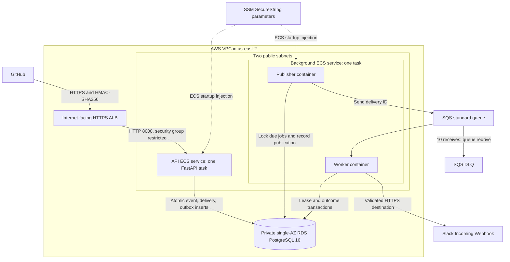

# Architecture

## System overview

The platform accepts signed GitHub webhooks, stores tenant-owned events and routing
results in PostgreSQL, and delivers Slack notifications asynchronously. One Python
codebase and container image provide three runtime commands: FastAPI, the outbox
publisher, and the delivery worker. Configuration is managed through trusted
operator SQL; no public tenant-management API is exposed.

## Deployed architecture

The ALB spans both public subnets. Each ECS service normally runs one task;
rolling deployments can temporarily add tasks. Publisher and worker are essential
containers in the same background task: failure of either replaces the task.
They have independent loops but share task-level scaling and IAM permissions.
The diagram shows logical service connections; SQS and SSM are regional services,
not resources placed inside these subnets.

## Networking and AWS permissions

- Public task IPs and an internet gateway provide outbound HTTPS without a NAT
  Gateway or interface endpoints. API inbound port 8000 accepts only the ALB
  security group. Background tasks have no inbound rules.
- RDS is not publicly accessible. Its security group accepts port 5432 only from
  API and background security groups. Database subnets have no internet route.
- Task roles authorize runtime SQS operations. Execution roles authorize ECR
  pulls, CloudWatch logging, and retrieval of the selected SSM parameters.
- ECS injects secrets into tenant-scoped environment variables at task startup;
  application code does not fetch arbitrary SSM parameters. Updating a parameter
  alone does not refresh an existing task's environment.
- An operator-run bootstrap task shares the background network rules and has a
  separate execution role allowed to retrieve the administrator secret. Normal
  service execution roles cannot retrieve that administrator secret.
- Bootstrap SQL authenticates with PostgreSQL credentials. IAM retrieves the
  secret; PostgreSQL grants authorize database operations. The bootstrap task
  requires no runtime AWS task role.
- An issued ACM certificate provides public HTTPS. ALB-to-API traffic is HTTP
  within the VPC. PostgreSQL connections use `PGSSLMODE=require`: encrypted,
  without the server-identity validation provided by `verify-full`.

Terraform uses an independently provisioned encrypted S3 backend with native
lockfiles. The state bucket, certificate/DNS, and SSM parameters are outside the
application root's lifecycle. See the [AWS runbook](../infra/README.md).

## Event ingestion and tenant isolation

`POST /webhooks/github/{source_id}` validates headers and body size, loads the
registered source, and verifies raw-body HMAC-SHA256 with constant-time comparison.
The source determines the tenant; the payload cannot choose one.

Within one explicit PostgreSQL transaction the API:

1. Locks the enabled source with `FOR SHARE` and verifies its secret/signature.
2. Inserts the event, deduplicating on `(source_id, github_delivery_id)`.
3. Finds enabled rules and destinations for that tenant and exact event type.
4. Inserts delivery and outbox records, then commits before returning HTTP 202.

A duplicate returns HTTP 200 with `duplicate`. Invalid signatures return 401.
Tenant-scoped queries and composite foreign keys prevent cross-tenant links.
A unique `(event_id, destination_id)` prevents multiple jobs to one destination
for the same event. PostgreSQL stores secret references, not raw secret values.

Configuration row locks require UPDATE privilege on at least one column per
table. The restricted `webhook_app` role receives `UPDATE (id)` on `sources`,
`rules`, and `destinations`; configuration fields such as `enabled` remain denied.
This also allows ID updates, a deliberate permission tradeoff covered by the
bootstrap documentation. No row-level security or self-service authorization
layer is claimed.

## Transactional outbox

Ingestion writes `events`, `deliveries`, and `outbox` atomically. The publisher
locks one due outbox row using `FOR UPDATE SKIP LOCKED`, sends only
`{"delivery_id": 123}` to SQS, and marks publication successful after SQS accepts it.
The row lock is held through the bounded send and database update.

Failed publication retries after 5 seconds, doubling to a 300-second cap, without
an application attempt limit. A crash after queue acceptance but before commit
can publish twice. The outbox prevents lost publication intent; it does not make
PostgreSQL and SQS one distributed transaction.

## Worker leases, retries, and DLQ

The worker processes one SQS message at a time. It claims due deliveries in a short
database transaction using a random lease token and database time, then commits
before the external HTTP request. Outcome writes check token ownership and lease
validity so an expired worker cannot overwrite a newer claim.

| Delivery state | Action |
|---|---|
| `succeeded` or `failed` | Skip Slack and delete the received queue message |
| Active lease or future retry time | Defer visibility; do not send or delete prematurely |
| Due pending job or expired lease | Claim if attempts remain; otherwise record terminal failure |
| Malformed message or missing delivery | Log a sanitized reason and leave for queue redrive |

Current limits are five claimed attempts, a 60-second lease, and 90-second SQS
visibility. Transient network errors, timeouts, HTTP 429, and server errors retry
with persisted scheduling; valid `Retry-After` values are respected. Permanent
failures and exhausted attempts become terminal database failures.

**Terminal application failures are recorded and their messages deleted; they do
not automatically go to the DLQ.** Queue redrive uses ten receives, which can
include crashes, deferrals, and infrastructure failures. Main queue retention is
four days; DLQ retention is fourteen days.

The [local recovery procedure](../README.md#inspect-and-recover-one-local-dlq-message) inspects
message IDs against database state and sends eligible nonterminal jobs back to
the main queue before deleting their DLQ receipt. It does not silently reset
terminal failures or application attempts. There is no automatic reconciliation
service; queue retention expiry can require operator intervention.

Slack destinations are restricted to the expected HTTPS host/path, public resolved
addresses, and a validated connection with TLS hostname verification. Redirects
and ambient proxy routing are refused. Secrets are tenant-scoped. A crash after
Slack accepts a request but before success is recorded can produce a duplicate:
external delivery is not exactly once.

## Storage, operations, and verification

Tables are `tenants`, `sources`, `destinations`, `rules`, `events`, `deliveries`,
and `outbox`. Migration 001 is operator-run; migrations do not run on application
startup. Bootstrap actions separately create the schema, restricted login, and
demo route. ECS services stay at zero tasks until bootstrap completes.

CloudWatch collects API access logs and sanitized publisher/worker outcomes with
seven-day retention. Custom alarms and comprehensive request correlation are not
implemented. The API currently hides database exception details behind 503;
that protects response data but limits diagnosis.

Local tests use PostgreSQL, pytest/HTTPX, and Moto. GitHub Actions builds the test
image and runs the normal suite; bootstrap tests are opt-in on an exclusive cluster.
See [recorded test results](../README.md#tests) for actual run scope.

Verified in the temporary AWS demonstration: both services running, healthy ALB
target, successful real GitHub-to-Slack delivery, and duplicate ingestion handling.
Both health endpoints returned 200 via a diagnostic TLS connection with explicit
certificate validation. Development-network DNS/TLS failures for normal custom-domain
requests were observed; their precise cause remains unresolved. GitHub successfully
used the normal HTTPS endpoint.

AWS worker outage recovery, controlled retry/DLQ recovery, load tests, and final
teardown remain unverified. See [screenshots](../README.md#deployment-evidence).

## Deployment tradeoffs and cleanup

The temporary Ohio deployment uses small tasks and a single-AZ database, without
autoscaling, multi-AZ failover, NAT Gateways, or interface endpoints. It demonstrates
backend reliability mechanisms, not a measured availability or throughput SLA.
Explicit SQL and simple processes keep the design understandable.

Save sanitized evidence, review a destroy plan, obtain approval, and inspect AWS
after teardown. Stopping ECS tasks does not stop ALB/RDS/storage charges. State,
SSM parameters, certificate/DNS, and bootstrap artifacts require separate review
because they are outside the application root. Do not claim teardown complete
until it is executed and verified.
